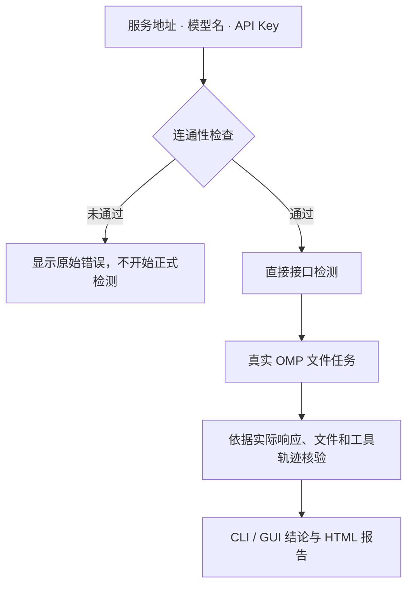

# AgentCheck

**验证模型服务能否接入、调用工具并完成真实 OMP 任务，结论有原始证据可查。**

提供服务地址、模型名称和 API Key，即可运行检测。交付程序内置 OMP 与所需运行组件，使用方无需安装 Node、Bun、Python 或 OMP。

`代码版本 0.4.8` · `检测规则 agentcheck/12` · `OMP 18.1.13` · `结果格式 v2`

[快速开始](#快速开始) · [检测内容](#检测内容) · [查看结果](#查看结果) · [开发与构建](#开发与构建) · [文档导航](#文档导航)

> **当前为试用候选版，不是跨平台正式发行版。** 已完成 macOS arm64、Linux x86_64 的原生 CLI 实测；Windows、Responses 真实服务、官方基线、签名/公证及完整跨平台发布验收仍未完成。不同平台需使用各自的构建产物。

## 检测如何进行



## 快速开始

以下命令在**已解压的 macOS arm64 或 Linux x86_64 对应程序目录**执行，适用于 Bash / Zsh。源码使用者先看[开发与构建](#开发与构建)。

### 1. 检查本机运行组件

```sh
chmod +x ./agent-check
./agent-check --offline-self-test
```

自检不请求模型；通过只说明内置组件可运行，不代表模型能力通过。

### 2. 配置待测服务

将以下内容保存为 `model.json`，替换地址与模型名：

```json
{
  "base_url": "https://model.example.com/v1",
  "model": "your-model",
  "api_key_env": "MODEL_API_KEY",
  "protocol": "chat-completions"
}
```

输入密钥，不回显，也不将密钥明文写入命令历史：

```sh
printf 'API Key: '
read -r -s MODEL_API_KEY
printf '\n'
export MODEL_API_KEY
```

`protocol` 可选 `chat-completions` 或 `responses`。基础地址会补上对应接口路径；完整接口地址必须与所选协议一致。也支持私有配置中的 `api_key`，但不要提交或分享含密钥的配置。

### 3. 开始检测

```sh
./agent-check --config ./model.json --no-gui --report-dir ./results
```

> 检测会产生真实模型用量，包含长输入与并发请求。请使用有额度、允许探测的服务；按 `Ctrl+C` 可取消并保存已有结果。

去掉 `--no-gui` 后，桌面环境可用时会自动打开 GUI，继续同一次检测；Linux 使用 CLI。连接失败只显示脱敏后的原始错误，不开展后续能力检测。

| 常用选项 | 用途 |
| --- | --- |
| `--json` | 使用 CLI，最终 JSON 写 stdout，进度写 stderr |
| `--no-open-report` | 不自动打开已生成的 HTML 报告 |
| `--no-color` | 关闭终端颜色 |
| `--offline-self-test --gui` | 离线打开桌面界面与本机历史，不调用模型 |

## 检测内容

**5 组直接接口检测 + 3 类 OMP 基础任务。** OMP 每类独立执行两次，共六次；检测项数量不等于 HTTP 请求数量。

| 类别 | 检测项 | 核对什么 |
| --- | --- | --- |
| 接口 | 接口与响应 | 普通与流式响应完整，前轮消息正确回传 |
| 接口 | 工具调用 | 工具选择、参数、调用 ID、结果回传及后续使用正确 |
| 接口 | 结构化输出 | JSON 可解析，字段、类型与实际内容符合要求 |
| 接口 | 长上下文 | 实测是否达到至少 128K tokens，继续探测容量；不测长文理解 |
| 接口 | 并发能力探测 | 普通短文本负载下，请求完成情况与完整响应耗时 |
| OMP | 连续工具执行 | 读取两个小文件、各一条记录，原样合并并实际写入 |
| OMP | 工具故障恢复 | 收到一次明确提示重试的临时读取错误后，继续完成同一任务 |
| OMP | 多轮继续执行 | 同一会话第二轮只修改一个字段，保留另一条记录及其余内容 |

### 并发：有界复核，不重试到全绿

- 按 `1 → 2 → 4 → 8 → …` 翻倍升档；平均完整响应时间 ≤ **10 秒**，P95 ≤ **20 秒**，少于 20 个请求时改看最慢耗时。单请求 **180 秒**是硬超时，不是合格线。
- **只有失败全部属于连接异常**时，等整档结束及 1 秒后，按相同并发完整复核一次；复核通过再升档，否则停止。每条 HTTP 请求仍只有一次尝试。
- 限流、超时、空回复、截断、鉴权、格式、HTTP 服务错误和混合失败不走连接复核。两轮不能拼成一轮“全部成功”，首次失败、请求数、等待和耗时都保留。
- 建议档位与连接风险分开报告。更高档连接异常时，已有合格档位可作为**带风险的试用起点**，不能解释成容量上限或长期稳定承诺。

### 判定边界

- **OMP 题目简单，验收不放松。** 使用原生文件工具，允许 `write` 或 `edit`；实际文件、来源读取、写入轨迹和正常结束都须核对，不能只凭模型说“完成”。
- **按证据区分失败原因。** 工具已恢复但最终写错数据，仍是结果错误；运行环境故障或证据不足不直接等于模型能力失败。
- **兼容不等于原生支持。** 结构化输出可兼容唯一 JSON 代码块，但会注明格式条件；直接工具项不以服务端 `strict` 强制约束为前提。
- **结论只覆盖本次范围。** 上下文下界不是精确最大值，基础任务通过不是通用知识、记忆或业务能力认证；旧报告保留当时规则，不用新题库补判。

更完整的预算、协议差异与异常处理见[使用手册](docs/customer/使用手册.md#4-检测内容报告与退出码)。

## 查看结果

每次运行创建独立目录，不覆盖历史结果：

```text
results/AC-<检测编号>/
├── report.html           # 面向使用者的结论、检测结果与使用建议
├── result.json           # 机器可读的版本、逐项状态与判定
├── records.zip           # 可下载的脱敏请求、响应、任务文件与证据
└── evidence-index.json   # 证据路径、大小及 SHA-256
```

打开 `report.html` 查看报告；页尾可下载检测记录，通过“打印 / 保存 PDF”导出 PDF。支持桌面的本机交互运行会尝试自动打开 HTML；JSON、SSH、CI 或取消时不弹窗，打开失败不影响已保存结果。

| 状态 | 含义 |
| --- | --- |
| 通过 | 本项要求已有验证证据；仍须遵守报告中的适用条件 |
| 未通过 | 已确认存在不满足本次要求的记录 |
| 未确认 | 证据不足、执行受阻或未正常完成，不能补判成功或模型失败 |
| 未执行 | 尚未运行，不计作通过或失败 |

CLI 退出码：`0` 通过、`1` 已确认失败、`2` 未完成或启动错误、`130` 用户取消。GUI 交接成功时入口返回 `0` 只表示窗口已接管，检测结论以报告为准。

未指定 `--report-dir` 时使用本机应用数据目录；macOS 默认为 `~/Library/Application Support/AgentCheck/results`。地址、模型、负载或检测版本变化后，应按新条件重新测量。

## 开发与构建

Rust 负责检测、OMP 调度、证据判定与报告，Electron 展示同一份结果。构建侧需要 Rust、Node/npm、Python，以及下载固定运行组件的网络权限；这些不是交付程序使用方的依赖。

```sh
ulimit -n 4096 && cargo test --locked
cargo clippy --locked --all-targets -- -D warnings
cargo fmt --check
node --test tests/desktop_*.test.cjs
```

macOS arm64 单文件构建与离线验证：

```sh
./scripts/build-macos.sh
python3 scripts/verify-runtime.py dist/agent-check --output .cache/runtime-verification.json
```

产物为 `dist/agent-check`。普通 `cargo build` 不等于内置完整运行时的交付构建；上面的构建脚本也不代表 Windows / Linux 打包或签名验收已经完成。

新增检测通过 `Registration` 提供版本化要求、执行器和证据验证器，交给 `engine::run_with_registry`；同时定义可验证的判据与正反例，不在界面另写一套判定。

## 文档导航

- [用户使用手册](docs/customer/使用手册.md)：拿到程序后的配置、自测、GUI 操作、结果解读和问题反馈。
- [无密钥配置模板](docs/customer/model.example.json)：填写你自己的服务信息。
- [实现状态与变更记录](docs/implementation-status.md)：版本变化、验证范围及发布缺口。
- [设计与验收要求](docs/agent-check-final-plan-2026-10-09.md)：产品范围和验收约束，早期方案以标注的后续修订为准。
